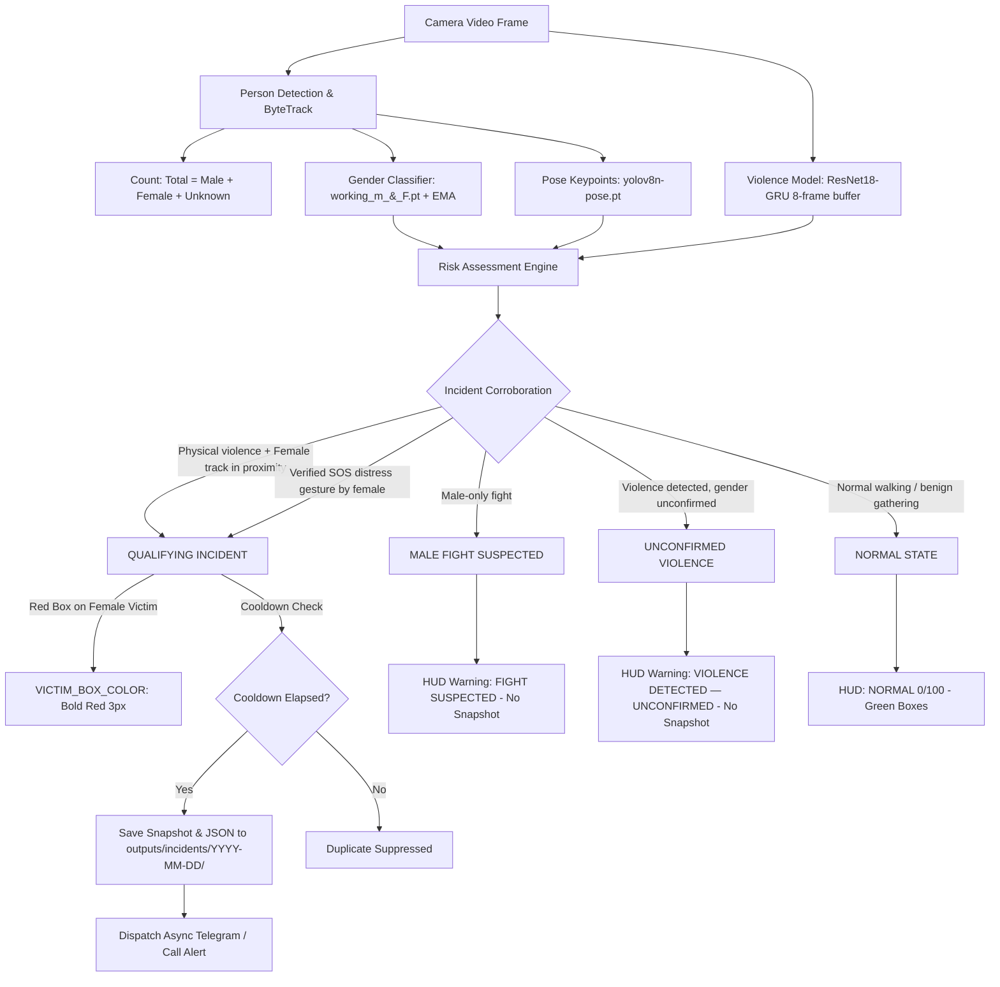

<div align="center">

# 🛡️ Guardian Eye: Women Safety AI Surveillance & Incident Response System

### Modular, High-Reliability Computer Vision Incident Monitoring System
**Live Webcam · Video Files · Image Analysis · IP/RTSP Streams**

[](https://www.python.org/)
[](https://pytorch.org/)
[](https://github.com/ultralytics/ultralytics)
[](https://opencv.org/)
[]()

</div>

---

## 📌 Executive Summary

**Guardian Eye** is an intelligent computer-vision safety monitoring and incident-response system engineered for Windows 10/11 (Python 3.11). It combines deep multi-object tracking, custom deep-learning temporal sequence modeling, gender classification, and heuristic motion analysis to detect real-world safety incidents involving women (assault, physical harassment, snatching, collapses, or distress gestures) while **strictly suppressing false alarms** from routine walking, male-only fights, or benign proximity.

When a credible threat involving a female victim is corroborated:
1. **Visual Highlighting:** The identified female victim is highlighted in **bold red** (`(0, 0, 255)`, thickness: 3) with an unmistakable alert label (`POTENTIAL WOMAN SAFETY INCIDENT`).
2. **Evidence Logging:** A high-resolution annotated snapshot (`.jpg`) and diagnostic telemetry (`.json`) are automatically persisted into dated folders (`outputs/incidents/YYYY-MM-DD/`).
3. **Emergency Dispatch:** Asynchronous non-blocking emergency alerts (Telegram photo dispatches, automated voice calls via Omnidimension, and police notifications) are queued and executed without dropping camera frames.

---

## 🏗️ System Architecture & Folder Layout

The project is organized into clean, modular subdirectories:

```text
Women-Safety/
├── main.py                     # Central interactive application entry point
├── config.py                   # Central application configuration & thresholds
├── requirements.txt            # Python dependencies
├── README.md                   # System architecture & technical manual
├── RUN.md                      # Operational guide & verification commands
├── .env.example                # Safe environment variable template (no credentials)
├── .gitignore                  # Git exclusions for outputs, logs, and venv
│
├── models/                     # Central organized model checkpoints
│   ├── person_detection/       # yolov8n.pt (YOLOv8 + ByteTrack tracker)
│   ├── gender_classification/  # working_m_&_F.pt (YOLO classes {0: female, 1: male})
│   ├── violence_detection/     # best.pt (PyTorch ResNet18-GRU on RWF-2000, 74.25% acc)
│   ├── fall_detection/         # yolov8n-pose.pt (17 COCO keypoint skeleton)
│   └── sos_detection/          # Distress gesture documentation & heuristics
│
├── src/                        # Modular source code
│   ├── detection/              # Person_Detection.py, Gender_Detection.py, Pose_Detection.py, Face_Detection.py
│   ├── tracking/               # Centroid_Tracker.py, ByteTrack utilities
│   ├── incident_detection/     # Violence_Detection.py, Snatching_Detection.py, SOS_Gesture_Detection.py, Risk_Assessment.py
│   ├── alerts/                 # Alert_Manager.py (async queue), Telebot_Alert.py, Call_Alert.py, Police_Station_Locator.py
│   └── utilities/              # Incident_Manager.py (dated storage), Evidence_Recorder.py, Video_Processor.py
│
├── outputs/
│   └── incidents/              # Qualifying incident snapshots & JSON telemetry (YYYY-MM-DD/)
├── tests/                      # Automated test suite (test_basic.py - 12/12 passing)
└── logs/                       # System diagnostic logs
```

---

## 🧠 Deep Learning & Vision Models

| Module | Checkpoint Location | Framework | Architecture & Input Pipeline | Classes & Outputs |
|:---|:---|:---|:---|:---|
| **Person Detection & Tracking** | `models/person_detection/yolov8n.pt` | Ultralytics YOLO | 640×640 RGB input + ByteTrack multi-object tracker | Bounding boxes, Track IDs, Person counts |
| **Gender Classification** | `models/gender_classification/working_m_&_F.pt` | Ultralytics YOLO | Crop IoU matching + Multi-frame Exponential Moving Average (EMA) | `{0: 'female', 1: 'male'}`, fallback: `'Unknown'` |
| **Violence / Fight Detection** | `models/violence_detection/best.pt` | PyTorch | ResNet18 (512-dim) + 1-layer GRU (hidden=256) + Linear(256, 2). 8 frames, 160×160, ImageNet norm. Val Acc: ~74.25% | `['NonFight', 'Fight']` with soft probability |
| **Fall Detection** | `models/fall_detection/yolov8n-pose.pt` | Ultralytics YOLO | 17 COCO keypoint skeleton + Temporal fall posture state machine | Collapses, aspect ratio inversion, post-fall stillness |
| **SOS Distress Gestures** | Heuristic + YOLOv8-pose | OpenCV / PyTorch | Wrists elevated above head / defensive shielding geometry | Overhead wave, shielding, manual 'S' key |
| **Theft & Snatching** | Heuristic + YOLOv8 | OpenCV | Carried objects + departure velocity differential ($> 650\text{ px/s}$) | Suden grab-and-flee actions |

---

## 🎯 Incident Decision Logic & Snapshot Rules

The system enforces strict qualification criteria before declaring an incident or writing evidence snapshots:



### Key Incident Rules:
1. **Restricted Area Removed:** No restricted zone polygon, boundaries, warnings, or controls exist.
2. **Female Victim Highlighting:** Only verified female victims involved in an incident receive a **BOLD RED** box (`(0, 0, 255)`, thickness: 3) and label `POTENTIAL WOMAN SAFETY INCIDENT`. Uninvolved females remain purple, males blue, and unknown gray.
3. **Snapshot Evidence Storage:** Snapshots and JSON summaries are written **only** when `is_qualifying_incident == True` into:
   ```text
   outputs/incidents/YYYY-MM-DD/INCIDENT_YYYYMMDD_HHMMSS_XXX.jpg
   outputs/incidents/YYYY-MM-DD/INCIDENT_YYYYMMDD_HHMMSS_XXX.json
   ```
4. **Duplicate Prevention:** A cooldown of 30.0 seconds (`QUALIFYING_INCIDENT_COOLDOWN_SECONDS`) prevents repeated disk writes for the same ongoing incident.
5. **No False Snapshots:** Male-only fights, distant unconfirmed females, or ordinary walking never trigger snapshots.

---

## 🚀 Running the Application

### 1. Environment Setup
The project runs inside the pre-configured `venv` with Python 3.11:

```cmd
cd /d D:\project\Women-Safety
venv\Scripts\activate
```

### 2. Interactive Launcher
Start the unified application:

```cmd
python main.py
```

The terminal displays an interactive source selection menu:
```text
======================================================================
  WOMEN SAFETY AI - INCIDENT DETECTION & ALERT SYSTEM
======================================================================
  Select what you want to monitor:
    [1] Webcam (Live camera feed)
    [2] Video File (Upload / browse .mp4, .avi, etc.)
    [3] Image File (Upload / browse .jpg, .png, etc.)
    [4] RTSP / IP Camera Stream (Enter stream URL)
    [5] Exit
======================================================================
```
- Press **`1`** (or Enter) to monitor your live camera feed.
- Selecting **`2`** or **`3`** opens the native Windows File Explorer to select any test video or photo directly.
- Press **`q`** in the video window at any time to exit gracefully.

### 3. Keyboard Shortcuts During Monitoring
| Key | Action | Function |
|:---:|:---|:---|
| **`s`** | **Manual SOS Trigger** | Instantly triggers distress alert and highlights the female track in bold red |
| **`r`** | **Reset State Engine** | Clears active risk scores and returns system state to `NORMAL` |
| **`q`** | **Quit / Exit** | Releases camera and closes UI gracefully |

---

## 🧪 Testing & Verification

Run the full automated test suite to verify all modules and models:

```cmd
python -m unittest tests/test_basic.py
```
*Result: 12 tests passing across configuration, ResNet18-GRU inference, YOLO models, and incident gating.*

Test static image analysis:
```cmd
python test_image.py
```

Test video processing pipeline:
```cmd
python test_video.py
```

---

## ⚙️ Configuration (`config.py`)

All major thresholds and operational parameters can be adjusted in [`config.py`](config.py):

| Parameter | Default | Purpose |
|:---|:---:|:---|
| `TEST_MODE` | `True` | Runs in safe demonstration mode (mock alert dispatches, logs to console) |
| `ALERTS_ENABLED` | `False` | Toggle external notifications (Telegram, Voice calls) |
| `VICTIM_BOX_COLOR` | `(0, 0, 255)` | BGR color for female victim box (Bold Red) |
| `VICTIM_BOX_THICKNESS` | `3` | Line thickness for female victim box |
| `QUALIFYING_INCIDENT_COOLDOWN_SECONDS` | `30.0` | Cooldown preventing duplicate snapshots for the same incident |
| `INCIDENT_SAVE_DIR` | `outputs/incidents` | Root directory for dated incident snapshots and JSON logs |
| `VIOLENCE_CONFIRMATION_FRAMES` | `3` | Temporal window requiring consecutive detections before alert trigger |

Credentials, bot tokens, and phone numbers are loaded securely from `.env` (refer to `.env.example`).
